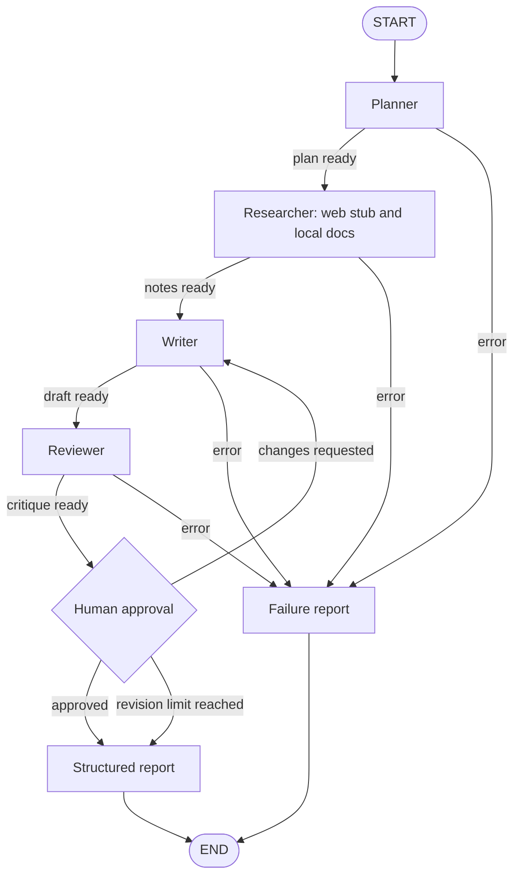

# Multi-agent LangGraph workflow

Portfolio demo by Arpan Bom.

This repository is a portfolio demo, not a production system. It runs a planner, a researcher, and a writer as a [LangGraph](https://docs.langchain.com/oss/python/langgraph) workflow, then asks a reviewer model for a critique and pauses for human approval. The default model is a fake provider, so the project runs without API keys. The web search tool is a stub over a fixed corpus. It does not call the public web. Nothing in this repository is a benchmark.

## Graph



The researcher calls two tools for every plan query: the web stub, and a search over the markdown files in `docs/`. Sources on the final report come from those hits. The model is not asked to invent citations.

Each model call has a small retry budget for timeouts, rate limits, and invalid JSON. If an agent still fails, the graph writes a failure report and stops. It does not keep looping.

Human approval is an interrupt. LangGraph checkpoints the thread, the process can exit, and a later command resumes the same thread. The fake reviewer always recommends `revise`. The person still decides. With the default `max_revisions` of 2, a rejection sends the draft back to the writer up to two times. The next rejection finishes the run with `approved: false`.

## Setup

From the repository root, on Python 3.11 or newer:

```bash
python -m venv .venv
source .venv/bin/activate
pip install -e ".[dev]"
```

The install does not download model weights.

## CLI

Start a run and leave it paused for approval. The default checkpoint file is `data/checkpoints.sqlite`.

```bash
workflow run "LangGraph human approval"
workflow status THREAD_ID
workflow approve THREAD_ID --notes "Approved for the demo"
```

Reject a draft and send it back to the writer:

```bash
workflow approve THREAD_ID --reject --notes "Shorten the summary"
```

`resume` is the same decision with an explicit boolean:

```bash
workflow resume THREAD_ID --approved true --notes "Approved for the demo"
```

`--yes` approves in the same process after the graph pauses. That is a convenience for a local walkthrough, not an unattended production mode.

```bash
workflow run "LangGraph human approval" --yes
```

`python -m workflow` calls the same CLI.

## API

```bash
workflow serve
```

That listens on `127.0.0.1:8000`. The same app is available as a factory:

```bash
uvicorn workflow.api:create_app --factory --host 127.0.0.1 --port 8000
```

```bash
curl -s -X POST http://127.0.0.1:8000/runs \
  -H 'content-type: application/json' \
  -d '{"topic":"LangGraph human approval"}'

curl -s http://127.0.0.1:8000/runs/THREAD_ID

curl -s -X POST http://127.0.0.1:8000/runs/THREAD_ID/approve \
  -H 'content-type: application/json' \
  -d '{"approved":true,"notes":"Approved for the demo"}'
```

`POST /runs/{thread_id}/resume` accepts the same JSON body as `/approve`. `GET /health` reports that the process is up. OpenAPI is at `/docs`.

A finished run returns a structured report: title, thesis, sections, tool sources, caveats, the approval flag, and any agent errors. The report always includes a caveat that this is a demo and that web hits are stubbed.

## Model providers

`LLM_PROVIDER` selects the client. The default is `fake`.

| Provider | `LLM_PROVIDER` | Credentials | Default model setting |
| --- | --- | --- | --- |
| Fake | `fake` | none | deterministic local responses |
| OpenAI | `openai` | `OPENAI_API_KEY` | `OPENAI_MODEL` (`gpt-4o-mini`) |
| Anthropic | `anthropic` | `ANTHROPIC_API_KEY` | `ANTHROPIC_MODEL` (`claude-3-5-sonnet-latest`) |
| Gemini | `gemini` | `GEMINI_API_KEY` | `GEMINI_MODEL` (`gemini-2.0-flash`) |
| Ollama | `ollama` | none | `OLLAMA_MODEL` (`llama3.2`) at `OLLAMA_BASE_URL` |

```bash
export LLM_PROVIDER=openai
export OPENAI_API_KEY=your-key
workflow run "LangGraph human approval"
```

Other settings: `CHECKPOINT_PATH` (`memory` keeps the run in process memory), `DOCS_DIR`, `MAX_REVISIONS` (0 through 5), `LLM_ATTEMPTS` (1 through 6), and `LLM_TIMEOUT_SECONDS`.

Hosted providers are plain HTTP clients. Tests never call them. They use `httpx.MockTransport` and the fake provider. Ollama is only used if you point the demo at a server you are already running.

## Tests

GitHub Actions runs `ruff check` and `pytest`. The suite does not need API keys, browsers, or model downloads.

```bash
ruff check .
pytest
```

## Layout

- `src/workflow/graph.py` builds the graph.
- `src/workflow/nodes.py` is the planner, researcher, writer, reviewer, and approval interrupt.
- `src/workflow/tools.py` is the web stub and local markdown search.
- `src/workflow/llm.py` and `src/workflow/providers.py` select the model client.
- `src/workflow/api.py` and `src/workflow/cli.py` are the two entry points.
- `docs/` is the local search corpus.
- `.github/workflows/ci.yml` runs lint and tests.

## Limits

- One process. SQLite is a local checkpoint file, not a production store.
- The web tool cannot see the live internet. Its locators use a `stub://` scheme.
- The fake provider returns fixed structured objects so the control flow is testable. It is not a model evaluation.
- Approval is in-process. There is no account system and no multi-user queue.
- This demo does not report quality scores, latency benchmarks, or leaderboard results.
